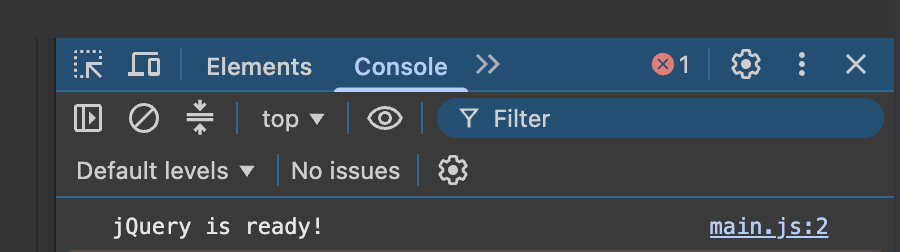
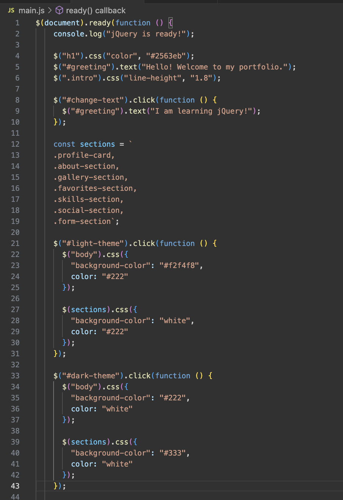
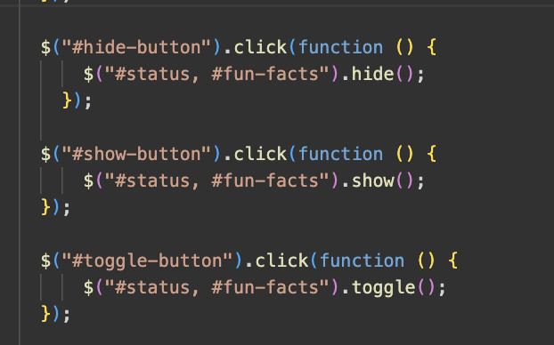
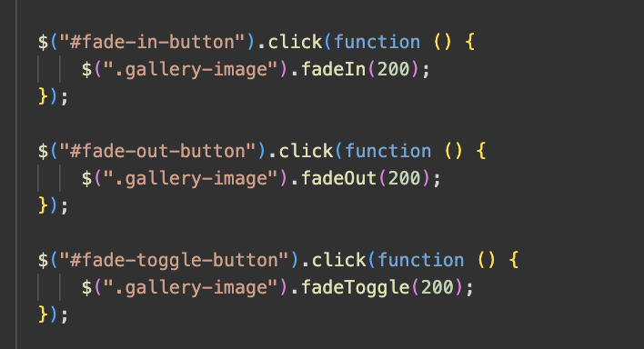
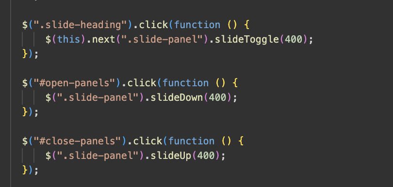
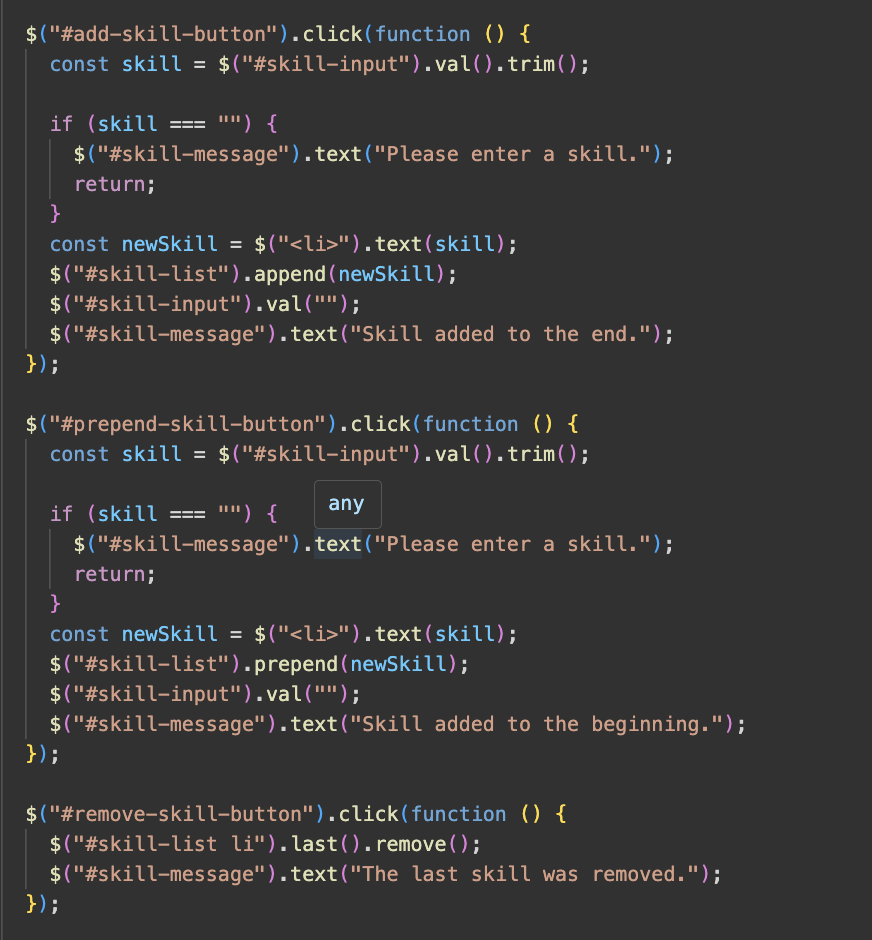
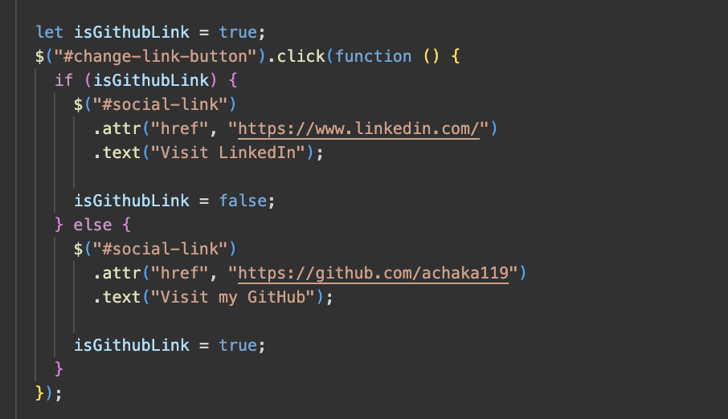
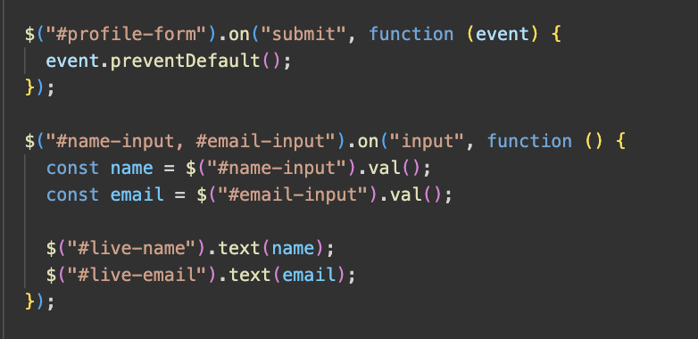
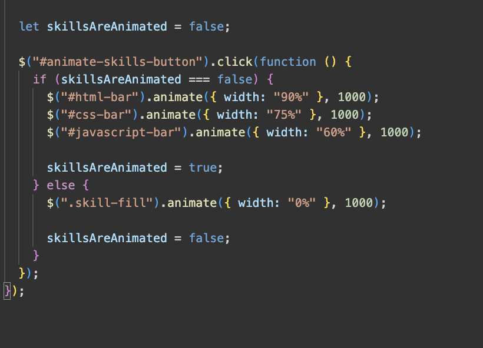

# Assignment 6 — jQuery Portfolio

## Name: Askar Kairatbek
## Group: it-2501

This project is a personal portfolio website created with HTML, CSS, JavaScript, and jQuery. It demonstrates jQuery selectors, effects, DOM manipulation, form interaction, and animations.

## Live Website

[Open the website](https://YOUR-USERNAME.github.io/YOUR-REPOSITORY/)

### Part 1 — Getting Started with jQuery

#### Task 0 — Setup

I connected jQuery using a CDN, added `$(document).ready()`, and checked that jQuery works in the browser console.

#### Task 1 — Selectors and CSS

I created a portfolio introduction and used tag, ID, and class selectors. I also changed text and styles with jQuery and added light and dark theme buttons.

### Part 2 — jQuery Effects
#### Task 2 — Visibility Methods

I added an About Me section with Hide, Show, and Toggle buttons.

#### Task 3 — Fade Methods

I added two images and used `fadeIn()`, `fadeOut()`, and `fadeToggle()`.

#### Task 4 — Slide Methods

I created three collapsible panels and used `slideUp()`, `slideDown()`, and `slideToggle()`.

### Part 3 — DOM Manipulation with jQuery
#### Task 5 — Add and Remove Elements

I created a list of technical skills. Visitors can add a skill to the beginning or end of the list and remove the last skill. Empty skills are not added.

#### Task 6 — Modifying Attributes

I added a social media link and a button that changes its destination using `.attr()`.

#### Task 7 — Form Interaction

I created a form with Name and Email fields. The entered information appears below the form while the user types.

### Part 4 — Animations

#### Task 8 — Basic Animation

I created three skill bars and used `.animate()` to fill them and return them to zero width.

## Summary
I created the page structure in HTML, added styles with CSS, and used jQuery to make the page interactive. I tested the buttons, effects, form, and animations in the browser. I also added screenshots of each task to this report.
